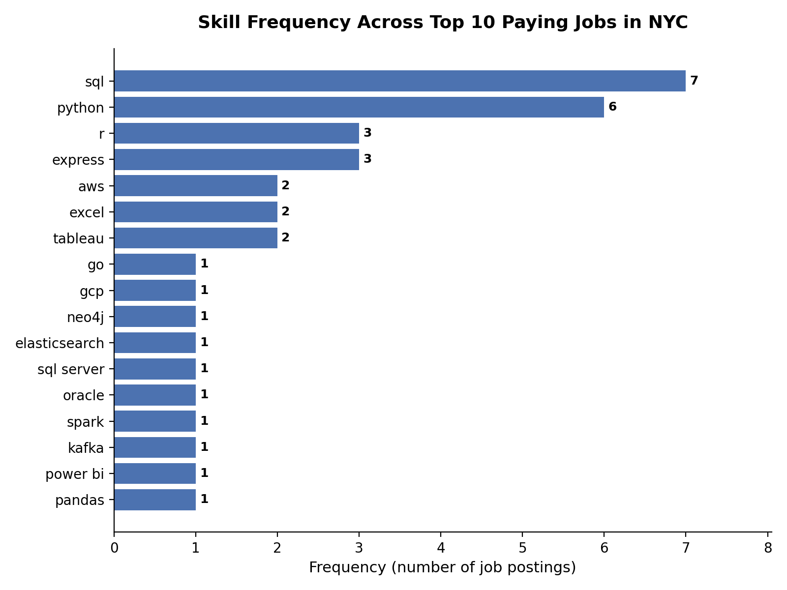
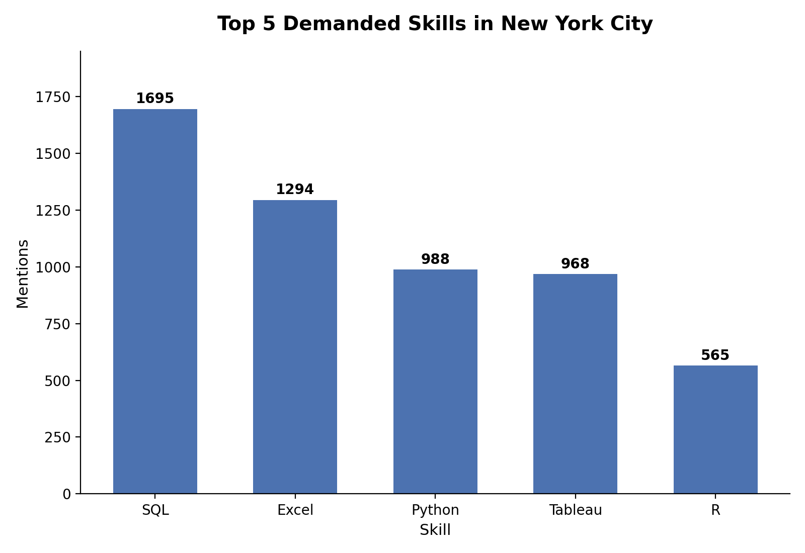

# Introduction
This project explores the intersection of **top paying** and **high demand** skills in **data analysis**. The project delivers valuable insights for Data Analysts on the top paying skills that are in demand in **New York City** 🗽. 

Check out the queries here:
[project_sql_folder](/project_sql)

# Background
I am currently a student studying Applied Data Science. Driven by my passion for  data and fondness for New York City, I wanted to complete a project that intertwined the two. I landed on this excellent [course](https://youtu.be/MOzEvNYvbik) by [Luke Barousse](https://www.youtube.com/@LukeBarousse) that did just that.

### The questions I wanted to answer through my SQL queries were :

1. What are the top paying data analyst roles in NYC ?
2. What skills are associated for these top paying jobs ?
3. What skills are most in demand for data analysts in NYC ?
4. Which skills are associated with higher salaries in NYC ?
5. What are the most optimal skills to learn – skills that are highest in demand and pay the most in NYC ?

# Tools I Used

For my analysis into the New York, data analyst job market, I used the following tools :

- **SQL** : The essential programming language for querying large databases
- **PostgreSQL** : My chosen database management system
- **VS Code** : The golden standard and an excellent choice for easily connecting to databases and executing SQL queries
- **Git & GitHub** : The best choice for both version control and sharing my project

# The Analysis

Each query for this project aimed at investigating specific aspects of the data analyst job market. Here’s how I approached each question and interpreted my results : 

### 1. What are the top paying data analyst roles in NYC ?

To identify the top paying data analyst roles in New York City, I filtered the table for data analyst roles located in NYC. Also, I discarded rows where salary was null. The query highlights top paying opportunities in New York City in descending order. 

```SQL
SELECT
    name AS company_name,
    job_title,
    salary_year_avg,
    job_location
FROM 
    job_postings_fact
LEFT JOIN company_dim AS companies
    ON job_postings_fact.company_id = companies.company_id
WHERE
    salary_year_avg IS NOT NULL AND
    job_title_short = 'Data Analyst' AND
    job_location = 'New York, NY'
ORDER BY
    salary_year_avg DESC
LIMIT 10;
```

Here's the breakdown on the top paying data analyst roles in New York City :
- **Wide Salary Range** : The top 10 paying data analyst roles span from $175,000 to $240,000, indicating significant salary potential in the field in New York City
- **Diverse Employers** : Companies like Coda Search, TikTok, and Selby Jennings are among those offering high salaries. 8/10 of the results are unique, demostrating broad interest from several companies
- **Limited Industries** : Tech dominates the results, showcasing a concentration of industries in top paying data analyst roles


| Company | Title | Salary ($) | Location |
| :--- | :--- | :--- | :--- |
| Coda Search│Staffing | Data Sector Analyst - Hedge Fund in Midtown | 240000.0 | New York, NY |
| TikTok | Investigations and Insights Lead Data Analyst - USDS | 239777.5 | New York, NY |
| TikTok | Investigations and Insights Lead Data Analyst - USDS | 239777.5 | New York, NY |
| Selby Jennings | Reference Data Analyst | 225000.0 | New York, NY |
| Pronix Inc | Data Analysis Manager | 185000.0 | New York, NY |
| TikTok | Investigations and Insights Lead Data Analyst - USDS | 181177.5 | New York, NY |
| IRIS Software, Inc. | Business Analyst/Data Analyst Compliance | 180000.0 | New York, NY |
| Brewer Morris | Data Associate, Investor Relations | 180000.0 | New York, NY |
| Parabolic Career | Data Research Analyst | 175000.0 | New York, NY |
| Smarsh | Cloud Financial Data Analyst, Director - Financial Operations (FinOps) | 175000.0 | New York, NY |

*Table of the top ten paying data analyst roles in New York City and their respective companies, titles, and salaries*

### 2. What skills are associated for these top paying jobs ?

To understand what skills are associated with top paying data analyst roles in New York City, I combined the job postings with their skills data, revealing what skills employers value in high paying roles.

```SQL
WITH top_paying_jobs AS (
    SELECT
        job_id,
        name AS company_name,
        job_title,
        salary_year_avg,
        job_location,
        job_posted_date,
        job_schedule_type
    FROM 
        job_postings_fact
    LEFT JOIN company_dim AS companies
        ON job_postings_fact.company_id = companies.company_id
    WHERE
        salary_year_avg IS NOT NULL AND
        job_title_short = 'Data Analyst' AND
        job_location = 'New York, NY'
    ORDER BY
        salary_year_avg DESC
    LIMIT 10
)

SELECT 
    top_paying_jobs.*,
    skills
FROM 
    top_paying_jobs
INNER JOIN skills_job_dim AS skills_to_jobs
    ON top_paying_jobs.job_id = skills_to_jobs.job_id
INNER JOIN skills_dim AS skills
    ON skills_to_jobs.skill_id = skills.skill_id
ORDER BY
    salary_year_avg DESC
```

Here's the breakdown of the most demanded skills from employers in the top ten paying data analyst listings in New York City :
- **SQL** leads with a count of 7
- **Python** follows closely with a count of 6 while **R** falls behind with a count of 3, demonstrating the employers' preference for Python
- Interestingly, Web development software like **Express** are mentioned more than visualization software tools like **Tableau** and **Power BI** 

*Bar graph visualizing the count of skills mentioned in the top ten paying jobs for data analysts in New York City; Claude generated this graph from my SQL query results*

### 3. What skills are most in demand for data analysts in NYC ?

To further my analysis in identifying the top paying, in demand skills in New York City, I transitioned my focus to all data analyst roles in NYC and returned the top five skills frequently metioned.

```SQL
SELECT
    skills,
    COUNT(skills_to_jobs.job_id as mentions
FROM job_postings_fact
INNER JOIN skills_job_dim AS skills_to_jobs ON job_postings_fact.job_id = skills_to_jobs.job_id
INNER JOIN skills_dim AS skills ON skills_to_jobs.skill_id = skills.skill_id
WHERE 
    job_title_short = 'Data Analyst' AND
    job_location = 'New York, NY'
GROUP BY
    skills
ORDER BY
    mentions DESC
LIMIT 5;
```

Here's the breakdown of the five most demanded skills for data analyst roles in New York City : 
- **SQL** dominates the results and remains a required skill for  data analyst roles including the top paying ones in NYC found before
- **Excel** remains as a fundamental skill data analysts must know
- Programming languages and visualization tools like **Python**, **R**, and **Tableau** are critical to know. Interestingly, employers prefer Python over R
- **Tableau** appears as the popular choice for data visualization over **Power BI**


*Bar graph visualizing the count of the top five skills mentioned in data analyst roles in New York City; Claude generated this graph from my SQL query results*

### 4. Which skills are associated with higher salaries in NYC ?

After uncovering the skills most in demand, I wanted to discover the skills that earn the highest average salaries

```SQL
SELECT
    skills,
    ROUND(AVG(salary_year_avg), 0) AS avg_salary
FROM job_postings_fact
INNER JOIN skills_job_dim AS skills_to_jobs ON job_postings_fact.job_id = skills_to_jobs.job_id
INNER JOIN skills_dim AS skills ON skills_to_jobs.skill_id = skills.skill_id
WHERE 
    job_title_short = 'Data Analyst' AND
    salary_year_avg IS NOT NULL AND
    job_location = 'New York, NY'
GROUP BY
    skills
ORDER BY
    avg_salary DESC;
```

Here's the breakdown of the top paying skills in New York City from data analyst listings :
- Niche database software like **Neo4j**, **Elasticsearch**, and **Cassandra** yield the highest salaries
- **Hybid roles** involving data analysis and either the **cloud**, **web frameworks**, or **programming** appear towards the middle
- The most in demand skills like **SQL**, **Excel**, and **Python** do not appear in the top 15 paying skills

| Skills | Average Salary ($) |
| :--- | :--- |
| neo4j | 185000 |
| elasticsearch | 185000 |
| cassandra | 175000 |
| dplyr | 167500 |
| unix | 162500 |
| perl | 157000 |
| twilio | 150000 |
| spring | 147500 |
| c | 146500 |
| angular | 138516 |
| gcp | 135294 |
| kafka | 135000 |
| pandas | 133169 |
| scikit-learn | 130000 |
| linux | 127500 |

*Table of the top fiftheen paying skills with their respective average salaries*

### 5. What are the most optimal skills to learn – skills that are highest in demand and pay the most in NYC ?

My final query aimed at uncovering the skills that are both in demand and associated with high salaries by only aggregating skills greater than ten times.

```SQL
SELECT
    skills,
    COUNT(job_postings_fact.job_id) AS mentions,
    ROUND(AVG(salary_year_avg), 0) AS average_salary
FROM job_postings_fact
INNER JOIN skills_job_dim AS skills_to_jobs ON job_postings_fact.job_id = skills_to_jobs.job_id
INNER JOIN skills_dim AS skills ON skills_to_jobs.skill_id = skills.skill_id
WHERE
    job_title_short = 'Data Analyst' AND
    salary_year_avg IS NOT NULL AND
    job_location = 'New York, NY'
GROUP BY
    skills
HAVING
    COUNT(job_postings_fact.job_id) > 10
ORDER BY
    mentions DESC,
    average_salary DESC;
```

Here's the breakdown of the most optimal skills for data analysts in New York City :
- **SQL** stands out for its high demand and commands a high salary of $104,757 but lower compared to niche skills, indicating its wide availability and value by employers
- **Python** is the more popular choice for programming languages and earns a higher salary of $110,396 compared to **R** and **Go**
- Employers in New York City have a strong preference for **Tableau** over visualization tools like **Power BI** or **Looker Studio**, having more mentions than the two combined. Interestingly, **Looker** still commands a higher salary of $110,020 than the others
- **Excel** remains a fundamental skill to have but yields a lower salary of $92,450

| Skills | Mentioned | Average Salary ($) |
| :--- | :--- | :--- |
| sql | 206 | 104757 |
| excel | 140 | 92450 |
| python | 126 | 110396 |
| tableau | 116 | 100030 |
| r | 71 | 96083 |
| powerpoint | 41 | 98165 |
| power bi | 40 | 95999 |
| sas | 40 | 82010 |
| word | 35 | 91650 |
| go | 24 | 95667 |
| looker | 22 | 111020 |

*Table of the top ten most in demand skills and their respective salaries*

# What I Learned

This course by Luke Barousse was my introduction to SQL covering introductory and **advanced** topics :
- I learned how to construct simple queries and use the `WHERE` command to filter data
- I used logical operators like `AND` to attach multiple filters
- I organized my results using the `LIMIT`, `ORDER BY`, and `DISTINCT` commands
- I created and altered tables and expanded my analyses by using several joins like `LEFT JOIN` and `INNER JOIN`, and unions
- I aggregated data using functions such as `SUM()`, `AVERAGE()`, and `COUNT()` with commands like `GROUP BY` and `HAVING` to filter aggregations
- I learned how to cast values using `::`, used the `CASE` command, and the `EXTRACT` command to manipulate dates
- I learned how to host my own database using **PostgreSQL** and communicate with it in **VS Code**
- I learned version control and how to publish my project using **Git** and **GitHub**
- Finally, I developed r**eal-world puzzle-solving skills**, **investigated trends**, and turn questions into **actionable insights** using SQL queries

# Conclusions

### Insights

I discovered several insights from my analysis of job listings in New York City :
- **top paying Data Analyst Jobs in NYC** : The top paying data analyst roles in New York City offer a wide range of salaries from **$175,000 to $240,000** !
- **Skills for top paying Jobs** : From those jobs, **SQL** and **Python** emerged as required skills for earning a top salary
- **Most In-Demand Skills in NYC** : **SQL** and **Excel** were the most mentioned skills and remain as essential skills for all data analyst roles in New York City
- **Skills with Higher Salaries in NYC** : Niche database skills like **Neo4j**, **Elasticsearch**, and **Cassandra**, as well as **hybrid** roles are associated with the highest average salaries. 
- **Optimal Skills for the New York City, Data Analyst Job Market** : **SQL** dominates the market for demand and offers a high salary of over **six figures**, positioning it as one of the most **optimal** skills for data analysts in the New York job market

### Final Thoughts

This excellent course by Luke Barousse and final project developed my SQL skills and provides valuable insights into the New York City, data analyst job market. Aspiring data analysts can better position themselves in a very competitive job market like NYC by learning high-demand, high-salary skills like SQL. My exploration of job posting data highlights the significance of tools like SQL, Python, and Tableau for data analysts looking to break into the NYC job market, and the significance of specialization and hybrid skillsets for individuals seeking higher salaries in the field of data analytics in New York City. 
